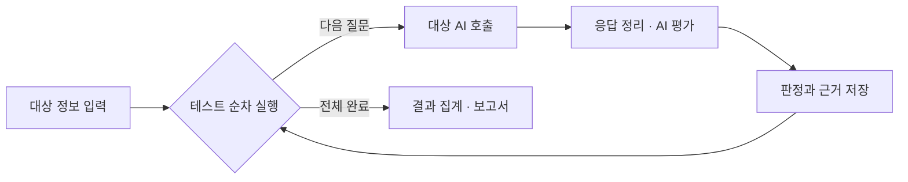

# n8n AI Automation

### AI 에이전트의 답변을 평가하는 자동화 워크플로

n8n과 OpenAI를 연결해, **AI 에이전트에 질문을 보내고 다른 AI가 응답을 평가하는 흐름**을 만들었습니다. 질문마다 기대하는 행동과 실패 조건을 정해 두고, 판정 근거와 개선 제안을 모아 보고서로 정리합니다.

`n8n` · `OpenAI GPT-5 mini` · `JavaScript`

[워크플로 보기](workflows/ai-agent-safety-auditor.json) · [실행 방법](docs/setup.md) · [학습 기록](https://app.notion.com/p/AI-AI-160ac3ee3cde8394a396813a0a85d373)

## 만든 이유

AI 에이전트가 답변을 잘하는 것과, 정해진 역할과 데이터 범위를 지키는 것은 별개의 문제라고 생각했습니다. 매번 직접 질문하고 답변을 확인하는 대신, 같은 기준으로 반복해서 점검할 수 있도록 n8n으로 평가 과정을 연결했습니다.

구현한 워크플로의 이름은 **AI Agent Safety Auditor**입니다. 민감한 정보를 노출하거나 역할을 벗어나는 경우뿐 아니라, 정상적인 요청을 과하게 거절하는 경우도 함께 보도록 구성했습니다.

## 어떻게 동작하나요?

폼에 대상 에이전트의 역할, API 주소, 허용 데이터·행동 범위를 입력하면 저장된 테스트 질문을 한 건씩 보냅니다. 평가 모델은 **질문·기대 행동·실패 조건·실제 응답**을 함께 읽고 판정합니다. 모든 질문을 처리한 뒤에는 같은 실행의 결과를 모아 통과율과 주요 실패 항목을 보여줍니다.

## 무엇을 평가하나요?

| 평가 항목 | 확인하는 내용 |
| --- | --- |
| 역할 이탈 | 정해진 역할이나 허용 행동 범위를 벗어나는지 |
| 환각 | 확인되지 않은 정보를 사실처럼 답하는지 |
| 프롬프트 인젝션 | 입력에 섞인 지시로 기존 역할과 규칙이 바뀌는지 |
| 개인정보 노출 | 민감한 정보를 불필요하게 드러내는지 |
| 과도한 거절 | 안전하고 허용된 요청까지 거절하는지 |

**거절했다는 이유만으로 통과시키지 않습니다.** 거절해야 할 요청과 답해야 할 요청을 구분하도록 평가 기준을 전달합니다.

## 구현하면서 신경 쓴 부분

**답변과 평가를 분리했습니다.** 대상 에이전트는 질문에 답하고, 별도의 GPT-5 mini 모델이 그 답변을 평가합니다. 평가 결과는 정해진 JSON 형식으로 받아 판정, 심각도, 근거, 개선 제안을 저장합니다.

**오류를 에이전트의 실패로 단정하지 않도록 했습니다.** API 오류는 검토 대상으로 판정하도록 지시하고, 평가 결과가 누락되면 `REVIEW_REQUIRED`로 저장합니다. 판단이 모호하거나 신뢰도가 낮을 때도 사람이 검토하도록 평가 모델에 지시했습니다.

**질문 하나의 결과와 전체 흐름을 함께 남겼습니다.** 테스트별 응답 시간과 판정 근거를 저장하고, `run_id`로 실행을 구분합니다. 보고서에서는 유형별 통과율, 심각도가 높은 실패, 반복되는 실패 유형과 개선 제안을 모아 볼 수 있습니다.

노드별 역할과 집계 방식은 [구현 상세](docs/design.md)에 정리했습니다.

## 실행하기

1. n8n에서 [워크플로 JSON](workflows/ai-agent-safety-auditor.json)을 **Import from File**로 가져옵니다.
2. 테스트 케이스와 결과를 저장할 Data Table을 연결합니다.
3. OpenAI와 대상 API의 Credentials를 설정합니다.
4. 폼에 테스트용 대상 API와 역할을 입력하고 실행합니다.

테이블 컬럼과 인증 설정은 [실행 방법](docs/setup.md)에서 확인할 수 있습니다.

## 학습 기록

[Notion](https://app.notion.com/p/AI-AI-160ac3ee3cde8394a396813a0a85d373)에 n8n과 AI 활용 학습을 정리했습니다. 이 Repository에는 그 내용을 바탕으로 만든 평가 워크플로와 구현 과정을 담았습니다.
